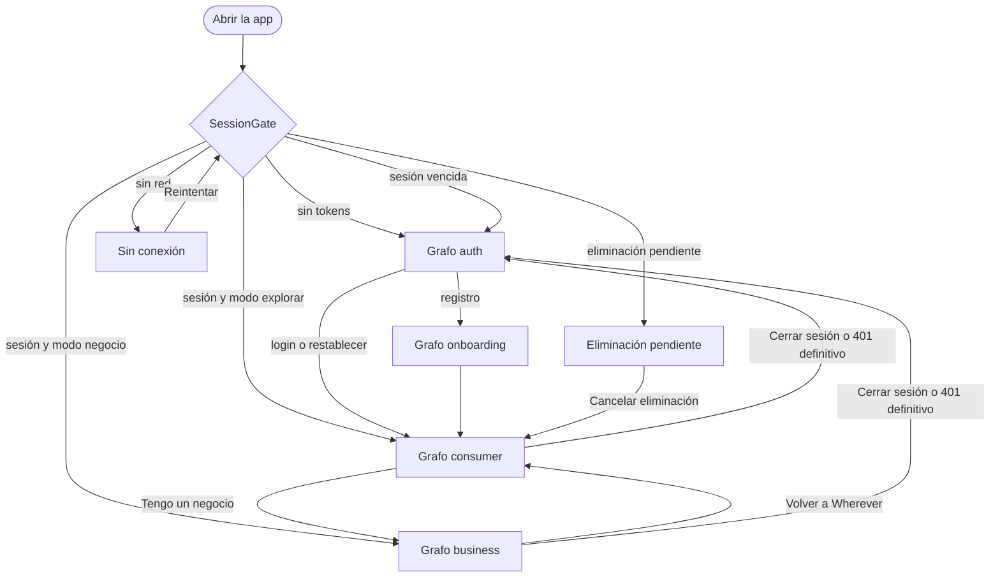
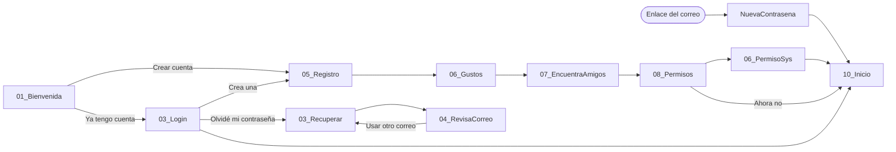
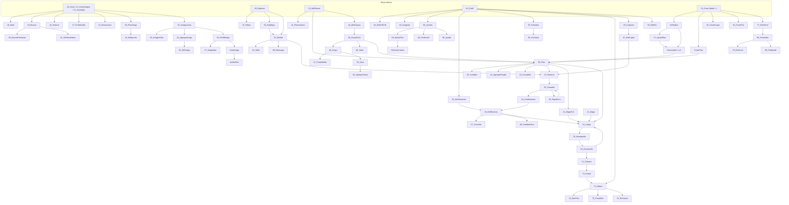
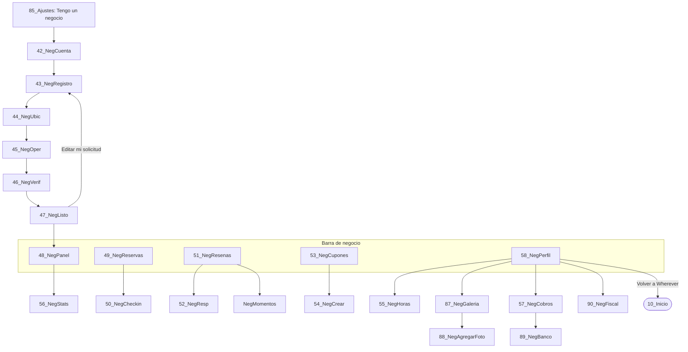

# 001 — Flujo general

> Rector: `.specify/memory/constitution.md`. Plantilla: `.specify/templates/spec-template.md`. Arquitectura: `specs/000-arquitectura/spec.md`.
> Fuente: `maqueta/figma-frames/` (revisados los 162 frames) y `docs/contexto_api_sprint1.md`. Índice y dudas: `specs/README.md`.

## 1. Objetivo

Describir cómo se conectan las pantallas: el mapa de navegación y los flujos de usuario y de negocio. Cada pantalla se detalla en su propia spec (`002` a `034`).

## 2. Alcance / No-alcance

**In:** mapa completo de la maqueta, flujos principales y reglas transversales.

**Out:** detalle por pantalla y endpoints, que están en cada spec.

### 2.1 Secciones de la maqueta

Las anotaciones `label · …` agrupan los frames en 11 secciones:

| # | Sección | Specs |
|---|---|---|
| 1 | Acceso y registro | 002, 003, 004, 005, 006, 007 |
| 2 | Inicio, feed y notificaciones | 013, 014, 015 |
| 3 | Amigos | 016 |
| 4 | Explorar y lugares | 017, 018 |
| 5 | Crear plan con IA | 019, 020 |
| 6 | Compartir, grupos y chats | 021, 022 |
| 7 | Reserva, pago y mis planes | 023, 024, 025 |
| 8 | El día del plan | 026 |
| 9 | Recuerdos y reseñas | 027, 028 |
| 10 | Perfil, ajustes y estados | 009, 010, 011, 012, 029 |
| 11 | Negocio | 030, 031, 032, 033, 034 |
| — | Sin pantalla: sesión y tokens | 008 |

### 2.2 Flujo de usuario

1. **Arranque.** El splash decide: Bienvenida, Inicio, Login o Sin conexión.
2. **Alta.** Registro → gustos → encuentra amigos → permisos → Inicio. Son 4 pasos en la maqueta (ver D12 para el Sprint 1).
3. **Descubrir.** Inicio muestra lugares cercanos y actividad de amigos. Explorar filtra por lista o mapa.
4. **Armar.** El botón + abre: plan con IA, plan a mano, planear con amigos, compartir un momento o reseñar. La IA recibe una palabra y genera el plan en 4 pasos visibles.
5. **Ajustar.** En el plan se cambian, quitan y agregan paradas. Se comparte o se invita.
6. **Decidir en grupo.** Chat, votación del lugar, punto medio y Vaca virtual, que solo calcula: Wherever no mueve dinero.
7. **Reservar.** Elegir hora, cupón automático, pagar anticipo en la pasarela y recibir código y QR. Se puede cambiar la hora o cancelar.
8. **El día del plan.** Mapa, cómo llegar, navegación y check-in con QR escaneado por el negocio.
9. **Después.** Postal, reseña verificada, publicación en el feed y recuerdos. "¿Repetimos?" vuelve a empezar el ciclo.

### 2.3 Flujo de negocio

1. **Alta en 5 pasos.** Cuenta, negocio, ubicación, operación, fotos y verificación. Se puede guardar y salir.
2. **Revisión.** Wherever revisa en 24 a 48 horas. Mientras tanto ya se entra al panel.
3. **Operación diaria.** Panel con reservas, anticipos y ocupación. Reservaciones por día. Check-in por código o QR.
4. **Reputación.** Responder reseñas, cuidar el Sello y agradecer los momentos públicos de clientes.
5. **Atraer clientes.** Cupones y cupo por hora para llenar las horas tranquilas.
6. **Administrar.** Perfil, galería, cobros semanales, cuenta bancaria y datos fiscales. "Volver a Wherever" regresa al modo consumidor (`POST /usuarios/yo/modo`).

## 3. Contratos (API y navegación)

**[Decisión propuesta]** Cuatro grafos anidados (`specs/000-arquitectura §2.4`). Las rutas se registran en `docs/routes.md` al implementar cada spec. Barra inferior según D22.

### 3.1 Vista general

### 3.2 Acceso y onboarding

### 3.3 Consumidor

### 3.4 Negocio

**Relación entre ambos lados:** una reserva del consumidor aparece en `49_NegReservas`. El QR de `26_DetReserva` se escanea en `50_NegCheckin`, lo que produce `26_CheckinOk` y habilita la reseña verificada. Una reseña (`68_PostVisita`) llega a `51_NegResenas`, y su respuesta (`52_NegResp`) se ve en `79_MisRes`. Un cupón de `54_NegCrear` aparece en `29_Cupones`.

### 3.5 Destinos ajenos a la navegación normal

| Origen | Destino |
|---|---|
| Enlace de restablecer (`#token=`) | `NuevaContrasena` |
| Enlace de verificar correo | Confirmación (sin frame) |
| Enlace de exportación | Descarga de datos (sin frame) |
| Enlace de plan (`42_Compartir`) | `29_PlanAmigo` |
| Push (`87_PushBloqueo`, `88_PushBanner`) | Reservación, votación, reseña o `15_Llegar` |

Si la sesión venció, pasan primero por Login y retoman el destino (US-013).

## 4. Modelo de datos

Sin modelo propio. Ver cada spec.

## 5. Seguridad y privacidad

- Rutas sin parámetros sensibles; los tokens de enlaces no entran en la navegación (`specs/000-arquitectura §2.4`).
- Los grafos no protegen datos por sí solos: el rol se valida en el servidor (403).

## 6. Tests / Gates

- UI: `SessionGate` lleva a cada destino de §3.1.
- `scripts/check_routes.sh` cuando exista (`nv-01`), con las rutas de `docs/routes.md`.

## 7. Plan de entrega

Documento de referencia. Se actualiza cuando una spec cambie la navegación. Orden sugerido para el Sprint 1: `008`, `002`, `003`, `005`, `004`, `006`, `012`, `009`, `010`, `011`.

## Aprobación
- [ ] Revisor 1 — fecha:
- [ ] CHECKLIST_PR.md OK
- [ ] Sin conflicto con constitución

**Estado:** 🚧 Borrador.
