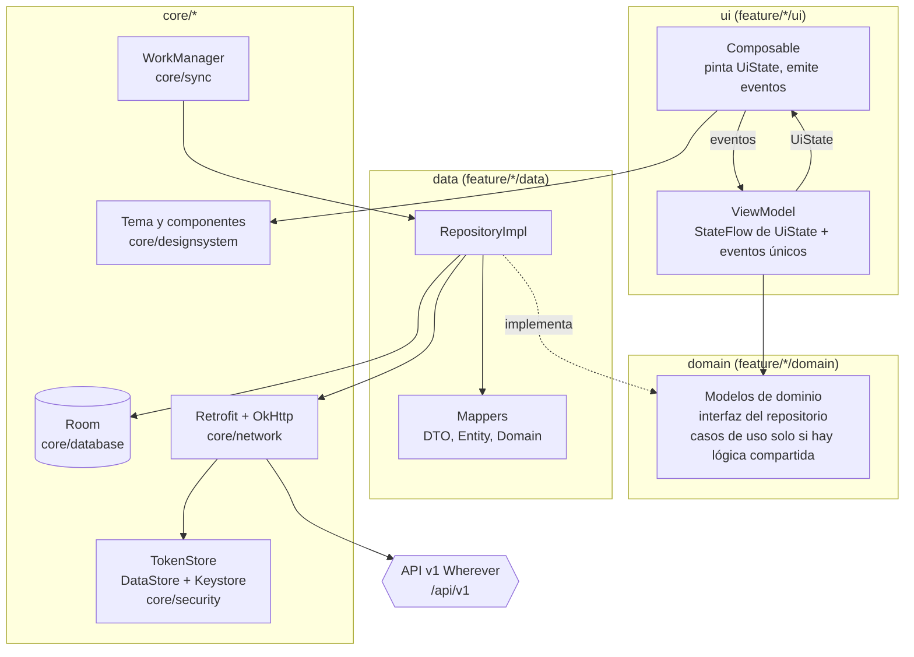
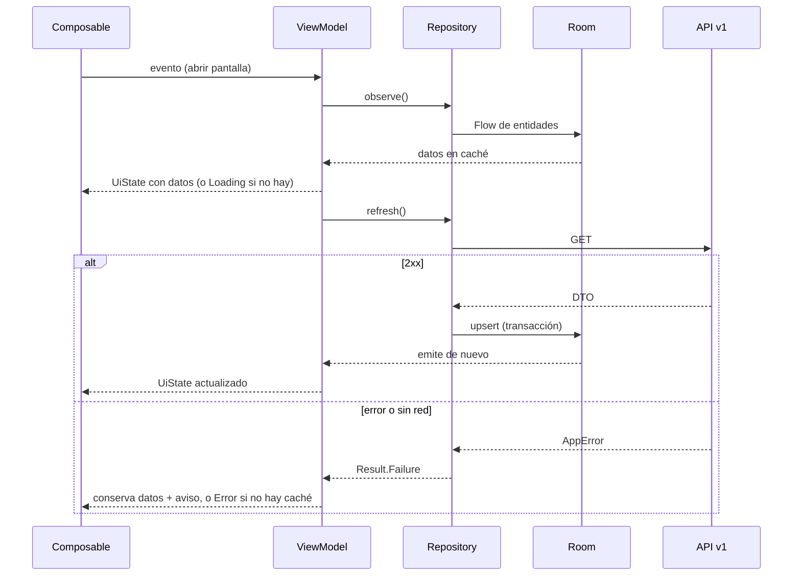
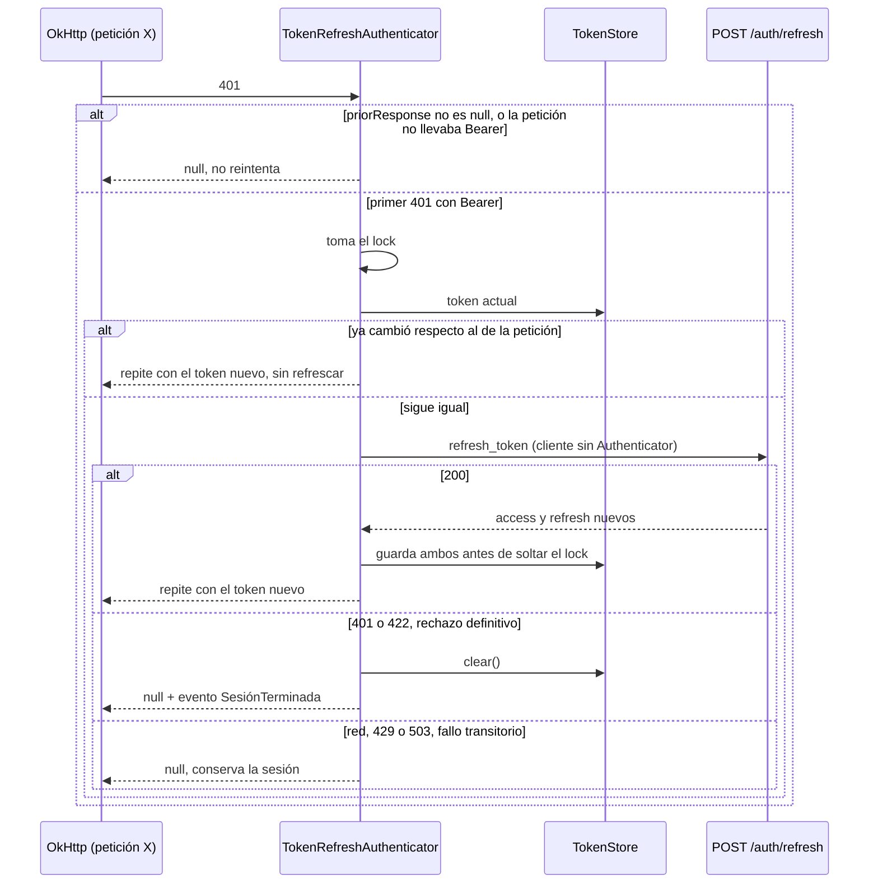

# NV-04 — Arquitectura de Wherever Móvil

> Rector: `.specify/memory/constitution.md` (manda ante conflicto). Plantilla: `.specify/templates/spec-template.md`.
> Consolida en un solo lugar lo que `nv-00`, `nv-01` y `nv-02` fijan por separado, y lo aterriza a la API v1 real (`docs/contexto_api_sprint1.md`).
> Convención de esta spec: **[Constitución §n]** = no negociable. **[Decisión propuesta]** = la constitución no lo define; se propone con su porqué y queda abierto a revisión.

## 1. Objetivo

Definir capas, patrón, navegación, estado, red, almacenamiento de tokens, inyección de dependencias, paquetes y convenciones para que cada funcionalidad (`specs/002+`) se construya igual y salga liberable.

La app **solo habla con la API v1** (backend Go, staging `https://18-227-230-50.sslip.io`, prefijo `/api/v1`). Nunca se conecta a MongoDB ni a ninguna otra base del backend.

## 2. Alcance / No-alcance

**In:** decisiones de arquitectura, estructura de paquetes y convenciones. El proyecto Gradle mínimo y la pantalla `home` vacía (`nv-01` R1-R3).

**Out:** FCM y mapas reales. La cadena de red, `TokenStore`, Room y las primeras pantallas se implementaron el 2026-11-04 (ver `specs/README.md`).

### 2.1 Capas y patrón

**[Constitución §3-§4]** MVVM: `ViewModel → Repository → Room / Retrofit`. Room es la fuente de verdad: la red actualiza Room y la UI lee de Room. Los Composables solo pintan y envían eventos.



Regla de dependencia: `ui → domain ← data`. `ui` no importa `data`, Retrofit ni Room; `domain` no importa Android. La comprueba Konsist (`nv-02`).

**[Decisión propuesta] Módulo Gradle único `app`, capas por paquete.** Porqué: `nv-01` R1 pide "módulo `app`"; con un equipo pequeño la multimodularización no compensa todavía, y Konsist da la misma garantía de capas. Se reevalúa cuando se mida el tiempo de compilación (constitución §2.5).

**[Decisión propuesta] Casos de uso opcionales.** El ViewModel llama al repositorio; solo se crea caso de uso si la lógica se repite entre pantallas. Porqué: la constitución define `ViewModel → Repository`; una capa obligatoria sería pura indirección.

### 2.2 Flujo de datos



**Excepción a Room como fuente de verdad [Decisión propuesta]:** las respuestas que son acciones y no datos reutilizables (`/auth/*`, `correo-disponible`, `ciudades/autocompletar`) no pasan por Room. Porqué: no hay nada que mostrar sin red, y credenciales o tokens jamás deben llegar a una tabla. El perfil de `GET /usuarios/yo` sí se persiste; `usuario` de las respuestas de sesión no, porque está incompleto.

### 2.3 Estado

- **[Constitución §4]** Un `UiState` por pantalla, expuesto con `StateFlow`.
- **[nv-02]** `UiState` y `BaseViewModel` en `core/ui`; eventos de una sola vez (navegar, snackbar) por canal aparte.
- **[Constitución §2.4]** Toda pantalla con datos cubre cargando, vacío, error y sin red.
- **[Decisión propuesta]** Formularios: `data class <Pantalla>UiState(campos, errores por campo, enviando)`, no la forma sellada. Porqué: un formulario conserva lo escrito durante envío y error; un `sealed` lo perdería.
- **[Decisión propuesta]** Eventos con `Channel<UiEvent>(BUFFERED)` expuesto como `Flow`. Porqué: `SharedFlow` sin réplica los pierde si no hay colector durante un cambio de configuración.

### 2.4 Navegación

- **[Constitución §4]** Navigation Compose con rutas tipadas, registradas en `docs/routes.md`.
- **[Decisión propuesta]** Rutas como `@Serializable object/data class` (API de Navigation 2.8+). Porqué: es lo que da tipado real y kotlinx.serialization ya es parte del stack.
- **[Decisión propuesta]** Grafos anidados por contexto: `auth`, `onboarding`, `consumer` (con barra inferior) y `business`. El destino inicial lo decide un `SessionGate` observando sesión y `modo_actual`. Porqué: limpia la pila al entrar o salir de sesión y aísla el lado negocio.
- **[Decisión propuesta]** Un 401 definitivo emite por `SessionEvents` y la raíz navega a Login recordando el destino pendiente (US-013). Porqué: el `Authenticator` no conoce la UI.
- **[Constitución §6]** Sin parámetros sensibles en rutas. El token de `#token=XYZ` se lee del `Intent`, va al `ViewModel` y al cuerpo de la petición; nunca entra en una ruta ni en logs.

## 3. Contratos (API y navegación)

### 3.1 Cliente HTTP

**[Constitución §3-§4]** Retrofit + OkHttp + kotlinx.serialization. Cadena fija y en este orden, con `Authenticator` aparte:

```
RequestId → AuthHeader → RedactedLogging   +   Authenticator (solo refresh)
```

| Pieza | Responsabilidad |
|---|---|
| `RequestIdInterceptor` | Agrega `X-Request-Id` (UUID). Se loguea junto con el de la respuesta. |
| `AuthHeaderInterceptor` | Agrega `Authorization: Bearer <access_token>` si hay token y la ruta no es pública. |
| `RedactedLoggingInterceptor` | Solo en debug. Redacta `Authorization` y los cuerpos de `/auth/*` y `/usuarios` (`password`, `*_token`, `token`, `telefono`). |
| `TokenRefreshAuthenticator` | Ante 401, renueva una sola vez y repite la petición. |

> **Nota sobre el encargo:** se pidió "un interceptor que agregue Bearer y haga refresh". La constitución §4 separa ambas cosas: interceptor para la cabecera y `Authenticator` para el refresh. Manda la constitución; el comportamiento pedido es el mismo.

**[Decisión propuesta] Detalles del cliente**
- Base: `BuildConfig.API_BASE_URL`, con barra final. `/health` y `/ready` viven fuera del prefijo y se declaran con ruta absoluta.
- `Json { ignoreUnknownKeys = true; explicitNulls = false }`. Porqué: la API agrega campos ("con más módulos aparecen más claves") y varios son `null`.
- DTO en inglés con `@SerialName("campo_real")`. Porqué: inglés en código (§5), JSON en español.
- Timeouts provisionales: conexión 10 s, lectura y escritura 15 s (fail-fast, §2.4). Se ajustan al medir (§2.5).
- Cada POST que abre sesión manda `dispositivo` (`modelo`, `sistema`, `app_version`) desde un `DeviceInfoProvider`.

### 3.2 Refresh de token

La API **rota** el refresh token y **reusar uno viejo cierra todas las sesiones**. Por eso dos peticiones que reciben 401 a la vez no pueden refrescar por separado. Esto es lo más delicado de la capa de red.



- **Un solo intento [Constitución §6]**: `response.priorResponse != null` corta el ciclo.
- **Lock único [Decisión propuesta]**: serializa los refresh; quien espera compara su token con el actual y reutiliza el nuevo. Porqué: evita el reuso del refresh token.
- **Cliente aparte para `/auth/refresh` [Decisión propuesta]**: sin `AuthHeader` ni `Authenticator`, con `RequestId` y logging redactado. Porqué: evita recursión.
- **Login con clave errónea no refresca**: `/auth/login` responde 401 sin haber llevado Bearer, y ese 401 llega a la UI tal cual.
- **Fallo transitorio [Decisión propuesta, requiere confirmación]**: la constitución §6 dice "si el refresh falla, se limpia la sesión". Se interpreta "falla" como **rechazo del servidor** (401/422). Sin red o con staging apagado no se cierra la sesión. Porqué: offline primero (§2.1), y staging se apaga todas las noches: cerrar sesión ahí expulsaría al usuario sin motivo.

### 3.3 Errores

**[Constitución §4]** La forma `{ codigo, mensaje, campos[] }` se mapea a `AppError`. La API agrega `traza_id`. `AppError` conserva los nombres de `nv-01` y **[Decisión propuesta]** agrega los casos que la API distingue y la UI trata distinto.

```kotlin
@Serializable
data class ApiErrorDto(
    @SerialName("codigo") val code: String,
    @SerialName("mensaje") val message: String,
    @SerialName("campos") val fields: List<FieldErrorDto> = emptyList(),
    @SerialName("traza_id") val traceId: String? = null,
)
```

| HTTP | `codigo` | `AppError` | UI |
|---|---|---|---|
| 400 | `solicitud_invalida` | `Unknown` | Error genérico; indica bug: se loguea con `traza_id` |
| 401 | `no_autenticado` | `Unauthorized` | Tras el refresh: a Login. En login: "correo o contraseña incorrectos" |
| 403 | `prohibido` | `Forbidden` | Mensaje; si la cuenta tiene eliminación pendiente, a esa pantalla |
| 404 | `no_encontrado` | `NotFound` | Estado vacío o mensaje |
| 409 | `conflicto` | `Conflict` | Según pantalla: correo ya existe; perfil desactualizado → recargar |
| 410 | `vencido` | `Gone` | Enlace vencido; pedir otro |
| 422 | `validacion` | `Validation(campos)` | Error bajo cada campo |
| 423 | `bloqueado` | `Locked` | Login bloqueado 15 min |
| 429 | `demasiadas_peticiones` | `RateLimited(retryAfter)` | Cuenta atrás con `Retry-After` |
| 503 | `no_disponible` | `Server` | Reintentar |
| 5xx sin cuerpo válido | — | `Server` | Reintentar |
| Sin conexión / DNS | — | `Network` | Estado sin red |
| Tiempo agotado | — | `Timeout` | Reintentar |
| Cuerpo ilegible | — | `Unknown` | Error genérico |

- Reglas: el `codigo` decide la lógica, no el texto de `mensaje`. `traza_id` se conserva en `AppError`. **La UI muestra el `mensaje` de la API** (encargo del 2026-11-04), con mayúscula inicial, y usa `strings.xml` si no hay mensaje (sin red, tiempo agotado) o si la pantalla pide un texto concreto (423 en login, 409 en perfil). `campos[].mensaje` va bajo su campo.
- **[Decisión propuesta]** El mapeo vive en una sola función `safeApiCall { }` de `core/network` que devuelve `Result<T>`. Porqué: un `CallAdapter` propio agrega magia sin ventaja, y esto es trivial de probar con MockWebServer.

### 3.4 Otros contratos transversales

- **Concurrencia del perfil**: `PATCH /usuarios/yo` exige `If-Match: "<version>"`. Con 409: "tus datos cambiaron en otro dispositivo" y se vuelve a pedir el perfil.
- **Cuenta con eliminación pendiente**: solo responden `GET /usuarios/yo`, cancelar eliminación y logout; lo demás da 403. El `SessionGate` lo detecta con `estado`/`eliminar_en`.
- **Enlaces de correo**: traen `#token=XYZ` en el fragmento. La app lo extrae y lo manda en el cuerpo.
- **Paginación**: `PageResult{items, siguienteCursor, limite}` **[Constitución §4]**. Ningún endpoint publicado en v1 pagina aún.
- **Rutas**: `docs/routes.md`. **Permisos**: `docs/permissions-matrix.md`.

## 4. Modelo de datos

`DTO → Mapper → Entity (Room) → Domain → UiState` **[nv-02]**.

- **[Constitución §5]** Room con esquemas exportados en `app/schemas` y migraciones explícitas, sin `fallbackToDestructiveMigration`.
- Una `WhereverDatabase` en `core/database`; cada feature aporta entidades y DAOs.
- **[Decisión propuesta]** `UserProfileEntity` es la primera entidad real (Sprint 1), con `version` para `If-Match`. Los objetos anidados (`gustos`, `preferencias`, `privacidad`) van con `@Embedded`. Porqué: el backend siempre los manda juntos y no se consultan por separado.
- **[nv-02]** `AppError`, `Result` y `PageResult` en `core/common`.

## 5. Seguridad y privacidad

### 5.1 Tokens: DataStore + Keystore

**[Constitución §6]** Tokens cifrados con Keystore, jamás en logs, `SharedPreferences` sin cifrar ni respaldos. **US-013** pide DataStore + Keystore.

**[Decisión propuesta] Diseño de `TokenStore`** (interfaz con `reset()`, `nv-01`):
- `DataStore<EncryptedTokens>` con `Serializer` propio que cifra todo el archivo.
- AES-256-GCM con clave de `AndroidKeyStore` (alias `wherever_tokens_v1`), IV aleatorio por escritura guardado junto al texto cifrado. Sin autenticación biométrica, para poder refrescar en segundo plano.
- Contenido: `access_token`, `refresh_token`, `expira_en`.
- Si no se puede descifrar (clave perdida, restauración): `CorruptionHandler` devuelve vacío, lo que equivale a sesión vencida y lleva a Login.
- Porqué DataStore + Keystore y no `EncryptedSharedPreferences`: esa API de `security-crypto` está obsoleta, y US-013 pide DataStore. Porqué sin Tink: la API de Keystore basta (MASVS CRYPTO: sin cripto propia, solo APIs de plataforma) y no agrega dependencias.
- **Excepción de stack** (constitución §3, regla de `nv-00`): `androidx.datastore` no está en la tabla. Licencia Apache 2.0, mantenida por Google. La pide US-013. Lo mismo para `androidx.core:core-splashscreen` (US-001). También `androidx.compose.material:material-icons-core`, para los íconos de la maqueta, y `androidx.hilt:hilt-lifecycle-viewmodel-compose`, para `hiltViewModel()`: Apache 2.0, de Google.

### 5.2 Red y plataforma

- **[Constitución §6]** `network_security_config.xml`: `cleartextTrafficPermitted="false"`, confía solo en CA del sistema.
- **[Constitución §6]** `allowBackup="false"` con `dataExtractionRules` que excluyen todo.
- Sin llaves en el repositorio: `API_BASE_URL` por `local.properties`/`BuildConfig`. `google-services.json` fuera de Git.
- `R8` en release (`docs/masvs-checklist.md`).
- **Logout (US-019)**: `POST /auth/logout`, luego `TokenStore.clear()` y borrado de tablas personales de Room, aunque la llamada falle.

### 5.3 Inyección de dependencias

**[Constitución §2.3, §3]** Hilt; sin estado oculto.

**[Decisión propuesta]** Módulos en `core/di`: `DispatchersModule`, `ClockModule`, `NetworkModule`, `DatabaseModule`, `SecurityModule`. Cada feature declara el suyo en `feature/<nombre>/data/di` con `@Binds` de repositorios. Calificadores `@AuthenticatedClient` y `@RefreshClient` para los dos OkHttp. `DispatcherProvider` y `Clock` se inyectan siempre.

### 5.4 Paquetes

Raíz: `com.wherever.mobile` **[Decisión propuesta]**.

```
com.wherever.mobile
├── WhereverApp.kt            # @HiltAndroidApp
├── MainActivity.kt
├── navigation/               # NavHost, rutas tipadas, SessionGate
├── core/
│   ├── common/               # Result, AppError, PageResult, DispatcherProvider
│   ├── data/                 # BaseRepository (nv-02)
│   ├── ui/                   # UiState, BaseViewModel (nv-02)
│   ├── designsystem/         # Color, Type, Theme, componentes base
│   ├── network/              # Retrofit, interceptores, Authenticator, safeApiCall
│   ├── database/             # WhereverDatabase, convertidores
│   ├── security/             # TokenStore y su implementación
│   ├── sync/                 # WorkManager
│   ├── notifications/        # Canal y FCM
│   └── di/                   # Módulos de Hilt
└── feature/<nombre>/
    ├── ui/                   # Screen, ViewModel, UiState
    ├── domain/               # Modelos, interfaz del repositorio
    └── data/                 # RepositoryImpl, Api, Dto, Entity, Dao, Mapper
```

### 5.5 Convenciones

**[Constitución §5]** Inglés en código y paquetes, comentarios y textos en español, todo texto visible en `strings.xml`. Colores y tipografías solo desde `core/designsystem`. Complejidad detekt ≤ 15. Áreas táctiles de 48 dp. Un solo botón principal naranja por pantalla.

**[Decisión propuesta]** Nombres: `<Pantalla>Screen`, `<Pantalla>ViewModel`, `<Pantalla>UiState`, `<Recurso>Api`, `<Recurso>Dto`, `<Recurso>Entity`, `<Recurso>Dao`, `<Recurso>Repository` e `<Recurso>RepositoryImpl`. `testTag` en estilo `pantalla_elemento`. Strings con prefijo de pantalla: `login_title`. Porqué: Konsist puede comprobar los sufijos y `check_strings.sh` agrupa por prefijo.

## 6. Tests / Gates

Suites de la constitución §7. Mínimos de esta arquitectura, además de los conteos de `nv-01`/`nv-02`:

| Suite | Caso |
|---|---|
| Unit | 401 con refresh OK → repite con el token nuevo; 401 tras reintento → no hay segundo refresh |
| Unit | Dos 401 simultáneos → **un solo** `POST /auth/refresh` (protege contra el reuso) |
| Unit | Refresh 401 → limpia sesión y emite evento; refresh con red caída o 503 → conserva sesión |
| Unit | 401 de login (sin Bearer) → no intenta refresh |
| Unit | Mapeo de cada `codigo` a `AppError`, cuerpo ilegible → `Unknown`, `Retry-After` → `RateLimited` |
| Data | `safeApiCall` con MockWebServer; `If-Match` y 409 del perfil |
| Security | Manifiesto (`allowBackup`, sin HTTP en claro); logging sin `Authorization` ni `password` |
| Security | `TokenStore`: el archivo en disco no contiene el token en claro; descifrado fallido → vacío |
| Arquitectura | Konsist: regla de capas, sufijos, sin `Dispatchers.IO` fijo, sin Retrofit en ViewModel |

Gates: `CHECKLIST_PR.md`, cobertura ≥ 45 %.

## 7. Plan de entrega

1. Spec aprobada → `specs/nv-04/plan.md`.
2. Proyecto Gradle con pantalla `home` y `assembleDebug` verde.
3. Ejecutar `nv-01` (red, `TokenStore`, Room) y `nv-02` (molde) con esta spec como referencia.
4. Sprint 1 (`specs/002+`) sobre ese molde.

## Aprobación
- [ ] Revisor: Jorge — fecha:
- [ ] CHECKLIST_PR.md OK
- [ ] Sin conflicto con constitución (interpretaciones a confirmar: §3.1 nota del encargo, §3.2 fallo transitorio, §5.1 excepción de stack)

**Estado:** 🚧 Borrador.
